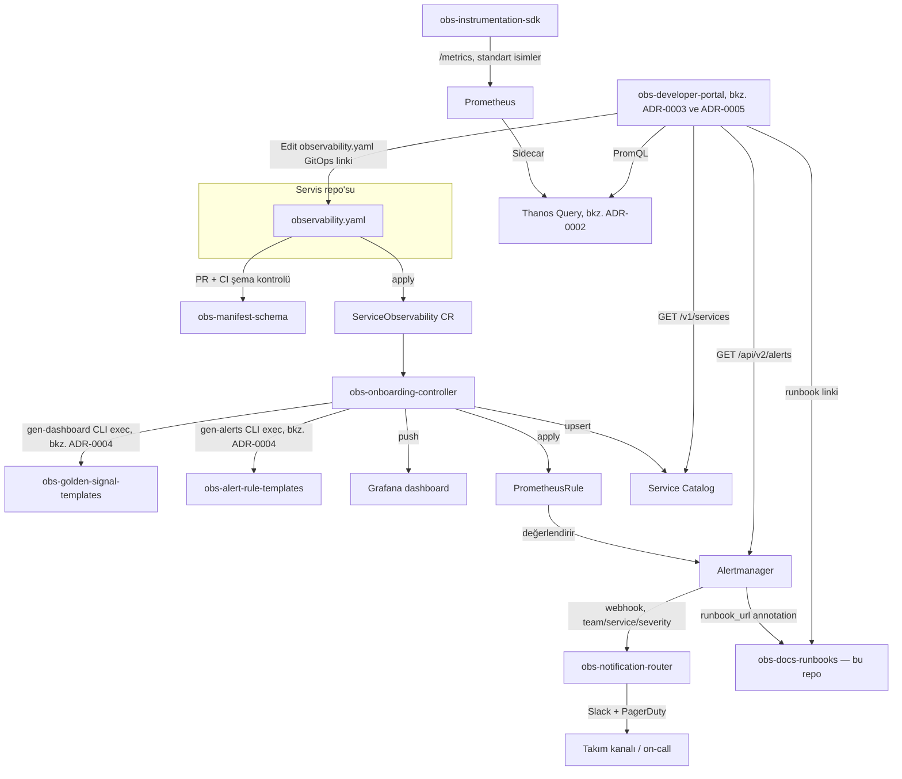

# obs-docs-runbooks

Platformun canlı dokümantasyonu: her alert için zorunlu runbook standardı,
mimari kararların (ADR) yaşayan kaydı, yeni bir takımın onboarding rehberi,
ve organizasyon genelinde SLI/SLO/SLA terimlerinin tek sözlüğü.

Yayınlanmış site: `https://runbooks.acme.com` (bkz. [§ Yayınlama
pipeline'ı](#yayınlama-pipeline-mkdocs-material)). Bu README, repo'nun
GitHub'daki karşılığıdır; site'ın kendi giriş sayfası [docs/index.md](docs/index.md)'dir.

## İçindekiler

- [Runbook standardı](#runbook-standardı)
- [ADR standardı](#adr-standardı)
- [Yayınlama pipeline'ı: MkDocs + Material](#yayınlama-pipeline-mkdocs-material)
- [Runbook URL konvansiyonu ve redirect katmanı](#runbook-url-konvansiyonu-ve-redirect-katmanı)
- [Onboarding rehberi](docs/onboarding/onboarding-guide.md)
- [Game Day checklist ve demo fixture](#game-day-checklist-ve-demo-fixture)
- [SLI/SLO/SLA sözlüğü](docs/glossary.md)
- [Platform mimarisi (yaşayan diyagram)](#platform-mimarisi-yaşayan-diyagram)
- [ADR indeksi](#adr-i̇ndeksi)

## Runbook standardı

Her runbook [docs/authoring-templates/runbook-template.md](docs/authoring-templates/runbook-template.md)'ten
türetilir ve yedi bölümün tamamını içermek **zorundadır**:

1. Alert Açıklaması
2. Olası Nedenler
3. İlk Müdahale Adımları
4. Escalation Kriteri
5. İlgili Dashboard Linki
6. Post-Incident Aksiyonlar
7. (front matter) `title`, `service_type`, `alert_types`, `severity`

`scripts/lint_runbooks.py`, CI'da (bkz. `.github/workflows/ci.yml`) bu
bölümlerden biri eksikse PR'ı kırar -- eksik bir runbook, "tamamlanmamış"
kabul edilir ve merge edilmemelidir.

Dört örnek, http servis tipi için eksiksiz yazılmıştır:

- [Error Budget Burn: Fast](docs/runbooks/http/error-budget-burn-fast.md)
- [Error Budget Burn: Slow](docs/runbooks/http/error-budget-burn-slow.md)
- [Latency SLO Violation](docs/runbooks/http/latency-slo-violation.md)
- [Saturation High](docs/runbooks/http/saturation-high.md)

Diğer servis tipleri için müdahale mantığının nasıl uyarlandığını gösteren
temsili bir örnek: [worker/error-budget-burn-fast.md](docs/runbooks/worker/error-budget-burn-fast.md).
Kalan servis tipleri (grpc, batch, database) için runbook'lar henüz
yazılmadı -- şablonu kopyalayıp bir PR açarak katkıda bulunun.

## ADR standardı

Her mimari karar [docs/authoring-templates/adr-template.md](docs/authoring-templates/adr-template.md)'ten
türetilir: Bağlam, Değerlendirilen Seçenekler (en az iki, artı/eksileriyle),
Karar, Sonuçlar (hem olumlu hem olumsuz), İlgili kararlar. `status` alanı
(`proposed`/`accepted`/`deprecated`/`superseded by ADR-XXXX`) bir kararın
hâlâ geçerli olup olmadığını okuyana anında söyler.

## Yayınlama pipeline'ı: MkDocs + Material

**Karar: MkDocs + Material tema**, Docusaurus değil. Gerekçe (tam ADR:
[ADR-0006](docs/adr/0006-mkdocs-over-docusaurus.md)): bu repo'nun içeriği
saf Markdown'dur, React/MDX interaktivitesine ihtiyaç yok; MkDocs Material
yerleşik arama, mermaid render'ı (ADR'lerdeki mimari diyagramlar için) ve
"bu sayfayı düzenle" linkini (`edit_uri`) kutudan çıkar çıkmaz sağlıyor,
Docusaurus'un Node.js build zincirinin karmaşıklığı olmadan.

```bash
pip install -r requirements.txt
mkdocs serve       # http://127.0.0.1:8000, canlı yeniden yükleme
mkdocs build --strict
python3 scripts/lint_runbooks.py
```

CI (`.github/workflows/ci.yml`): her PR'da lint + `mkdocs build --strict`
(bir uyarı bile build'i kırar) + redirect resolver'ın unit testi
(`node redirects/test-resolve.mjs`). Yayınlama
(`.github/workflows/publish.yml`): `main`'e her push'ta GitHub Pages'e
deploy; `CLOUDFLARE_ACCOUNT_ID` org variable'ı tanımlıysa redirect worker'ı
da otomatik günceller.

## Runbook URL konvansiyonu ve redirect katmanı

`obs-alert-rule-templates`'in ürettiği `runbook_url` annotation'ı ile
**birebir uyumludur**:

```
https://runbooks.acme.com/{serviceType}/{alertname}
```

`{alertname}` servis adını içerdiği (örn. `CheckoutApiErrorBudgetBurnFast`)
ama bu repo runbook'ları **alert tipi başına** (`error-budget-burn-fast`)
yazdığı için, GitHub Pages'in önünde ince bir redirect katmanı
(`redirects/cloudflare-worker.js`, alternatifi `redirects/nginx-alternative.conf`)
servis adı önekini tanınan dört suffix'e göre ayıklayıp kanonik sayfaya
yönlendirir. Detay: [redirects/README.md](redirects/README.md) ve
[docs/index.md](docs/index.md)'in "Runbook URL konvansiyonu" bölümü.

## Game Day checklist ve demo fixture

[docs/game-day-checklist.md](docs/game-day-checklist.md), platformun tüm
parçalarını (manifest lint → onboarding controller → dashboard/alert
oluşturma → gerçek trafik → alert tetikleme → notification routing →
Developer Portal → decommission) tek bir gerçek senaryo üzerinden uçtan
uca doğrulayan bir checklist'tir. Fixture'ları da gerçek, çalıştırılmış ve
doğrulanmıştır (mock değil):

- [demo/demo-checkout-service](demo/demo-checkout-service) --
  `obs-instrumentation-sdk`'nın Go kütüphanesiyle instrument edilmiş,
  gerçekten derlenip Docker imajı olarak build edilip çalıştırılmış sahte
  bir HTTP servisi; `observability.yaml`'ı `obsctl validate` ile
  doğrulanmıştır (`valid (obs.acme.com/v2)`). Kendi `/admin/failure-rate`
  endpoint'i, bir game day'in hata oranını kontrollü şekilde
  yükseltmesini sağlar.
- [loadtest/checkout-loadtest.js](loadtest/checkout-loadtest.js) -- k6
  script'i, iki senaryo halinde bu servise karşı gerçekten çalıştırılmıştır:
  `baseline` (sağlıklı trafik, `%0` hata) ve `incident` (servisin
  kendi failure-rate'ini `%50`'ye çekip 8 dakika sürdürülebilir trafik,
  `ErrorBudgetBurnFast`'ı tetiklemek için yeterli).

## Platform mimarisi (yaşayan diyagram)

Bu diyagram, bu oturumda inşa edilen platformun tüm repoları arasındaki
ilişkiyi gösterir. Bir repo değiştiğinde (yeni bir entegrasyon noktası
eklendiğinde), bu diyagramı güncellemek bu repo'nun sahiplerinin
sorumluluğundadır -- "yaşayan" olmasının anlamı budur.



## ADR indeksi

| ADR | Karar | Durum |
|---|---|---|
| [0001](docs/adr/0001-grafonnet-for-dashboard-templates.md) | Grafonnet ile dashboard şablonlama | accepted |
| [0002](docs/adr/0002-thanos-for-long-term-metrics.md) | Thanos ile uzun dönem/çoklu-cluster metrik sorgulama | accepted |
| [0003](docs/adr/0003-standalone-portal-vs-backstage.md) | Developer Portal: standalone vs. Backstage | accepted |
| [0004](docs/adr/0004-cli-exec-over-library-import.md) | Template render: CLI exec vs. kütüphane import | accepted |
| [0005](docs/adr/0005-polling-over-websocket.md) | Gerçek zamanlı güncelleme: polling vs. WebSocket | accepted |
| [0006](docs/adr/0006-mkdocs-over-docusaurus.md) | Bu repo için MkDocs vs. Docusaurus | accepted |

Yeni bir ADR eklemek için [docs/authoring-templates/adr-template.md](docs/authoring-templates/adr-template.md)'i
kopyalayın, `docs/adr/000N-kisa-baslik.md` olarak kaydedin, `mkdocs.yml`'in
`nav`ına ve yukarıdaki tabloya ekleyin.
