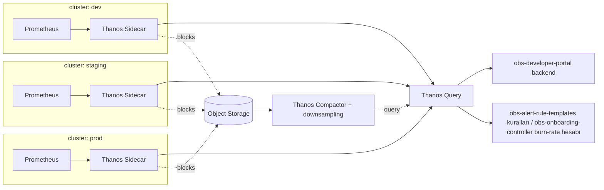

# ADR-0002: Thanos ile uzun dönem/çoklu-cluster metrik sorgulama

## Bağlam (Context)

Platform, tek bir Prometheus instance'ının doğal sınırlarına iki yerde
çarpıyor: (1) error budget hesapları 30 günlük `increase()` sorguları
gerektiriyor (bkz. `obs-alert-rule-templates`), bu da Prometheus'un
varsayılan (genelde 15-30 gün) retention'ının ötesinde veri saklamayı
gerektirir; (2) `obs-onboarding-controller` her ortam/cluster için ayrı bir
Prometheus çalıştırıyor (bkz. o repo'nun "environment overlay" tasarımı),
ama Developer Portal'ın (bkz. `obs-developer-portal`) Health Overview
sayfası tüm ortamlardaki servisleri **tek bir sorgu katmanından**
görebilmeli.

## Değerlendirilen Seçenekler

### Seçenek A: Prometheus'un kendi retention'ını uzatmak + federasyon
- Artı: Ek bileşen yok, mimari basit kalır.
- Eksi: Prometheus'un tek-node, local-disk mimarisi uzun retention'da
  disk maliyetini ve tek-node restart risk yüzeyini büyütür. `federate`
  endpoint'i, çoklu cluster'ı gerçek zamanlı sorgulamak için tasarlanmamış
  bir pull-tabanlı mekanizmadır -- her federasyon adımı ek gecikme ve
  kırılganlık ekler.

### Seçenek B: Thanos (Sidecar + Query + Store Gateway + Compactor)
- Artı: Object storage'a (S3/GCS uyumlu) sınırsız retention ile blok
  yazar; `Thanos Query`, birden fazla Prometheus/Thanos Sidecar'ı **tek bir
  PromQL endpoint'i** arkasında birleştirir -- Developer Portal'ın backend'i
  ve `obs-onboarding-controller`'ın burn-rate hesapları aynı sorgu
  arayüzünü (Prometheus HTTP API ile uyumlu) değiştirmeden kullanabilir.
  Downsampling (5m/1h) uzun pencereli sorguları (30 günlük `increase()`)
  ucuzlaştırır.
- Eksi: Ek operasyonel karmaşıklık -- object storage, Compactor'ın tek
  instance kısıtı, Sidecar/Receiver mimarisi seçimi gibi kendi
  öğrenilmesi gereken kavramları getirir. Cortex/Mimir gibi alternatiflere
  kıyasla community/tooling farkı zamanla değişebilir.

### Seçenek C: Mimir/Cortex (tam uzun-vadeli depolama sistemi)
- Artı: Yatay ölçeklenen, multi-tenant tasarım; büyük ölçekte Thanos'tan
  daha az operasyonel ince ayar gerektirebilir.
- Eksi: Bu platformun bugünkü ölçeği (onlarca-yüzlerce servis, birkaç
  cluster) Mimir'in tam dağıtık mimarisinin karmaşıklığını henüz
  gerektirmiyor; Thanos'un "mevcut Prometheus kurulumuna sidecar ekle"
  modeli, sıfırdan bir metrik depolama sistemi kurmaktan daha düşük geçiş
  maliyetlidir.

## Karar (Decision)

**Thanos seçildi.** Mevcut Prometheus/Prometheus Operator kurulumuna
(`obs-onboarding-controller` zaten Prometheus Operator'ü hedefliyor)
Sidecar eklemek, sıfırdan bir metrik depolama sistemine geçmekten daha
düşük geçiş maliyetlidir, ve Thanos Query'nin sunduğu tek-endpoint çoklu
cluster görünümü tam olarak Developer Portal'ın Health Overview
sayfasının ihtiyacı olan şeydir.

## Sonuçlar (Consequences)

- `obs-onboarding-controller`'ın `ObservabilityEnvironment` CR'si
  (bkz. o repo), her ortam için ayrı bir Prometheus/Alertmanager
  hedefleyebilir kalır (alerting hâlâ per-cluster Prometheus üzerinde
  çalışır, alerting gecikmesini Thanos Query'nin ek hop'una bağımlı
  kılmamak için) -- Thanos yalnızca **okuma/sorgu** tarafında devreye
  girer, alert değerlendirme mimarisini değiştirmez.
- Object storage maliyeti ve Compactor'ın tek-instance sınırlaması
  operasyonel bir dikkat noktasıdır; Compactor için `--consistency-delay`
  ve `--retention` ayarları platform ekibinin sahiplendiği ayrı bir
  runbook gerektirir (bu repo'nun kapsamı dışında, platform ekibinin kendi
  altyapı reposunda izlenir).
- Developer Portal'ın backend'i (bkz. `obs-developer-portal`), Prometheus
  HTTP API'sine göre yazıldığı için Thanos Query'yi hedeflemek kod
  değişikliği gerektirmez -- yalnızca `PROMETHEUS_URL` konfigürasyonu
  Thanos Query'nin adresini gösterir.

## İlgili kararlar

- ADR-0003 (Backstage vs standalone portal): Developer Portal'ın backend'i
  bu Thanos Query katmanını tüketir.
